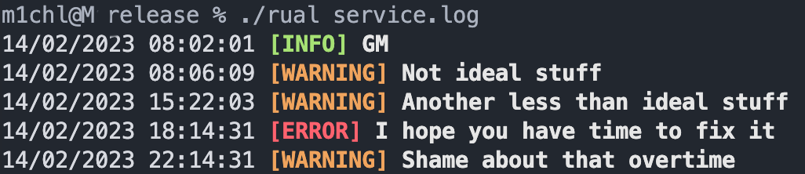

# Rust-a-Log

A local log viewer for files and live applications. Read recent records from large files, capture a command, or browse Go, Node.js, .NET, and Java logs in one terminal.

File tails use backward scans in 64 KiB blocks. The TUI shows named sources, connection status, structured fields, and recent records.



## Quick start

Install the current source with [Rust](https://rustup.rs/):

```sh
cargo install --git https://github.com/M1chlCZ/Rust-a-Log --locked
rual app.log -e -w -n 20
# Or start the live receiver and terminal interface:
rual tui
```

This shows the last 20 errors or warnings and follows new records. Press Ctrl+C to stop.
For a one-time text search, run `rual app.log -g timeout --ignore-case --once`.
See [Live sources and TUI](#live-sources-and-tui) for application streams and [Language adapters](adapters/README.md) for integrations.

The GitHub source is version **0.1.0**. The published crates.io version **0.0.1** provides the older file viewer and logger.
Install from GitHub to use the live receiver and TUI. Adapter source packages are in this repository.

## Build and install

Install [Rust with rustup](https://rustup.rs/), then run from this repository:

```sh
cargo build --locked --release
# Optional: install rual into your Cargo bin directory
cargo install --locked --path .
```

The published 0.0.1 CLI can be installed directly from crates.io:

```sh
cargo install rust-a-log --locked
```

The project pins **Rust 1.98.1**, uses edition 2024, and includes `Cargo.lock` for reproducible dependency resolution. Rustup installs the pinned compiler when you first build. The local binary is `target/release/rual` (`rual.exe` on Windows).

For a native Linux build, use the same commands on Linux. To cross-compile from macOS to x86-64 Linux, install [Zig](https://ziglang.org/download/) and [cargo-zigbuild](https://github.com/rust-cross/cargo-zigbuild), then run:

```sh
cargo install --locked cargo-zigbuild
./build_linux
```

The helper installs the Linux Rust target and writes `target/x86_64-unknown-linux-gnu/release/rual`. Missing tools and build errors produce a nonzero exit status. If linking fails, check your Zig and cargo-zigbuild versions; native builds do not need either tool.

## Usage

Put the file path first. By default, rual shows the last 10 records and follows new writes; press Ctrl+C to stop.

```sh
rual app.log                         # Last 10 records, then follow
rual app.log 50                      # Legacy positional count
rual app.log -n 50 --once            # Print last 50 records and exit
rual app.log -n 0                    # Only new records
rual app.log -e -w -n 20             # Last 20 errors OR warnings, then follow
rual app.log -g timeout --ignore-case --once
rual app.log -e -g database -n 5 --once
rual app.log --color never --once
rual --help
```

Counts apply **after filtering**: `-e -n 10` finds the last ten matching errors, even if they are scattered throughout the file. Multiple levels are combined with OR; the text search is an additional AND condition. Text search is literal, not a regular expression. `--ignore-case` compares lowercased Unicode text.

| Option | Meaning |
| --- | --- |
| `-n, --lines N` | Last N matching records; 0 skips existing content |
| `--once` | Print and exit |
| `-f, --follow [true\|false]` | Follow new writes; defaults to true |
| `-e, --errors [N]` | ERROR records |
| `-w, --warnings [N]` | WARN or WARNING records |
| `-i, --info [N]` | INFO records |
| `-s, --success [N]` | SUCCESS records |
| `-d, --debug [N]` | DEBUG records |
| `-t, --trace [N]` | TRACE records |
| `-g, --contains TEXT` | Literal text filter |
| `--ignore-case` | Case-insensitive text filter |
| `--color auto\|always\|never` | Auto respects terminal detection and NO_COLOR |

Legacy forms such as `rual app.log -e 20 --follow false` still work. `-n N` or positional N overrides the optional per-level counts. When combining legacy counts, the largest is used; a bare level flag contributes the default 10. Prefer `-n` when combining filters. A positional count and `-n` cannot be used together.

Compared with the original release, flags no longer switch between different reading modes: filtered invocations also follow by default. Add `--once` or `--follow false` to scripts that should terminate. `-f` means follow, not a file path.

## Records and following

One physical line is one record. Recognized labels are `[ERROR]`, `[WARNING]`, `[WARN]`, `[INFO]`, `[SUCCESS]`, `[DEBUG]`, and `[TRACE]`. The first recognized bracketed label determines the level, including after a bracketed timestamp. A word such as `ERROR` in ordinary message text is not a level; use `--contains ERROR` to search for it. Unlabelled records remain visible when no level filter is set.

- Handles empty files, CRLF line endings, long lines and malformed brackets. Invalid UTF-8 bytes display as replacement characters instead of crashing.
- Follow checks every 200 ms and keeps its last read position. Incomplete records wait for a newline, preserving UTF-8 characters split across writes. `--once` also prints a final line without a newline.
- Truncation below the current read position restarts at the beginning. Linux/macOS also reopen renamed or replaced logs, including after a temporary gap. Windows follows the original file handle and detects truncation; rename rotation requires restarting the viewer.
- Polling cannot detect every rewrite: a file truncated and regrown past the read position between polls can lose records. Writers should finish writing to an old rotated file before creating its replacement. An incomplete old record is discarded on detected truncation or rotation.
- File input must be a regular, seekable file. `-` reads stdin as a stream. Compressed logs and multiline grouping in plain text are not supported.
- Output can be piped. A closed receiving pipe exits cleanly. Terminal output replaces control characters that can execute terminal commands.

Memory use is proportional to the longest record plus a small read buffer, not total file size. A rare filter may still need to scan the whole file to find enough matches; no index or cache is maintained.

## Live sources and TUI

Start one local receiver:

```sh
rual tui
```

Applications connect to `127.0.0.1:7331`. Their adapters register a source name and send records to that receiver.
The source list shows each connection as a separate session, with its language, record count, and discarded count.
Disconnected sessions remain visible until the source history fills. A reconnect creates a new session.

Files can appear beside application streams:

```sh
rual tui --file app.log --file worker.log
```

Each file starts with its last 100 physical lines and uses the existing follow and rotation reader.
Live file sources have the same 64 KiB record limit as socket sources. An oversized line stops that source with a visible error.
The regular `rual app.log -n N` path keeps its large-file behavior and has no socket requirement.
Unfiltered file tails count newline positions without decoding or copying the scanned records.

For a plain stream or JSON output:

```sh
rual listen
rual listen --json
rual listen --bind 127.0.0.1:9000 --file app.log
```

`listen` and `tui` each own their receiver. Run one mode per address. The startup message goes to stderr.
Only registered applications and explicitly named files appear as sources.

| Key | Action |
| --- | --- |
| Left / Right | Select a source or all sources |
| Up / Down | Select a record and pause the view |
| Space | Pause or resume the view |
| `/` | Edit the text filter (message and fields, case insensitive) |
| Enter / Esc in the filter | Finish the edit |
| Backspace in the filter | Delete the last character |
| `l` | Cycle through log levels |
| Enter | Show the full message and structured fields |
| Page Up / Page Down | Scroll the details |
| `q`, Esc, Ctrl+C | Exit and restore the terminal |

A pause keeps a bounded snapshot while the receiver continues to accept new records.
The TUI needs an interactive terminal. `listen` supports pipes.

## Capture a command or stdin

Capture stdout and stderr without an adapter:

```sh
rual run --name api -- dotnet run
rual run --tui --name web -- node app.mjs
rual run --json -- go run .
```

`run` does not start a socket receiver. Each record has a `stream` field (`stdout` or `stderr`).
It preserves the child exit code for normal exits. An exit caused by a signal returns status 1.
The captured command gets no stdin. On TUI exit, rual stops its direct child and restores the terminal.
Ctrl+C in plain capture stops the direct child and returns status 130.
Commands that create detached children can outlive that child.

For an existing pipe:

```sh
docker logs --follow my-app 2>&1 | rual - -e
```

Stdin emits matching records as they arrive and stops at EOF. It also emits a final line without a newline.
`-n` and positional counts require a file. Legacy counts on level flags do not limit a stream.
Stdin and process records have a 64 KiB line limit. The regular file viewer continues to accept long lines.

## Language adapters

The repository includes Go slog, Node.js/TypeScript and Pino, .NET ILoggerProvider, Java JDK logging, and Logback adapters.
See [adapter installation and examples](adapters/README.md).
All adapters use the same [version 1 protocol](docs/protocol.md).

The adapters are extra logging outputs. Keep existing file or console outputs for durable logs.
Each adapter uses a background sender, a queue of 64 records, and a 64 KiB frame limit.
It reconnects without a network wait in the application logging call.

The stream is best effort. A disconnect, full queue, process crash, or expired history can discard records.
The receiver keeps 2,000 records or 8 MiB of serialized record data. It accepts at most 32 clients and remembers 128 sources.
Expired history and rejected clients appear in the TUI. The plain stream reports skipped history on stderr.
Adapter drop counts reach the receiver after a later successful send. Local counters remain available while the receiver is absent.

The receiver accepts only loopback bind addresses. It does not authenticate other local users.
Use it on a trusted development machine. Containers need a route to the host listener, or process capture through `docker logs`.

## Performance

Local macOS ARM64 measurement on a 256 MiB log (2,097,152 records of 128 bytes), printing the last 10 matching errors:

| Release binary | Median elapsed time | Peak resident memory |
| --- | ---: | ---: |
| Original | 223 ms | 313 MiB |
| Updated | 6.3 ms | 1.9 MiB |

These are the original modernization measurements from September 2026.
Five alternating runs followed a file-cache warmup. The timer included process startup.
Both binaries produced identical output. The original version requested nine records to compensate for its off-by-one bug.
A unit test also enforces that recent tails do not read the old prefix.

The October live-stream build still reads ten recent records from a 256 MiB file in about 6 ms on the local Mac.
Its larger CLI uses about 6 MiB of resident memory. This remains independent of total file size for short tail records.
Startup overhead is slightly higher than the earlier file-only build. Results depend on the machine, disk, and log format.

## Logger library

The logger is published on crates.io as `rust-a-log` (the Rust import name is
`rust_a_log`). Add the dependency to your application:

```toml
[dependencies]
rust-a-log = "0.0.1"
```

Then import and use it:

```rust,no_run
use rust_a_log::{Level, Logger};

fn main() -> std::io::Result<()> {
    let logger = Logger::new("app.log")?;
    logger.log_message("Application started", Level::Info)?;
    Ok(())
}
```

It appends timestamped records and supports `Trace`, `Debug`, `Info`, `Warn`, and `Error`.

For the current source library without CLI dependencies:

```toml
rust-a-log = { git = "https://github.com/M1chlCZ/Rust-a-Log", default-features = false }
```

## Development

```sh
cargo fmt --all --check
cargo test --locked
cargo clippy --locked --all-targets -- -D warnings
cargo build --locked --release
cargo check --locked --no-default-features
```

CI runs the Rust checks on Linux, macOS and Windows. The adapter job also runs these checks on Linux:

```sh
(cd adapters/go && go test -race ./...)
(cd adapters/node && node --test)
dotnet run --project adapters/dotnet/Example -- --check
(cd adapters/java && mvn test)
python3 scripts/check-adapters.py
```

The last command runs all four language examples against the real receiver.
It needs the Go, Node.js, .NET 10, Java 17+, and Maven tools. Run `cargo build --locked` first.

`src/tail.rs` owns file reading. `src/live.rs` owns the protocol and bounded receiver.
`src/capture.rs` handles process, stdin, and headless output. `src/tui.rs` owns the terminal view.
`src/logger.rs` retains the Rust file logger API.

For compiler updates, change `rust-toolchain.toml` and `package.rust-version` in `Cargo.toml`, then run the checks above. For dependency updates, run `cargo update`, review `Cargo.lock`, and run the checks before committing the lockfile.

## Support

If this project helps you, you can support its development.

[](https://ko-fi.com/m1chl)
<a href="https://buymeacoffee.com/xdujifyzvt"></a>

## License

[MIT](LICENSE).

If this project helps you, consider giving it a star. Bug reports and contributions are welcome.
